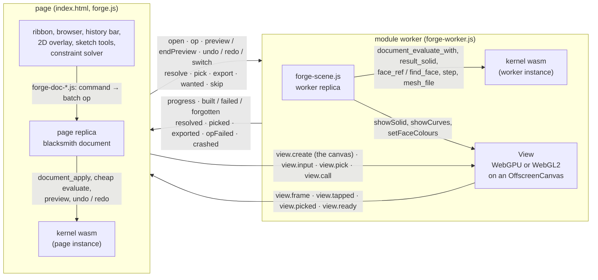

# cadaclysm forge

A parametric CAD modeller that runs in the browser and makes exact B-rep solids. Sketch
curves on a plane, hold them with constraints and dimensions, then extrude, revolve,
sweep, loft, join, cut, fillet, chamfer and shell them. Every body is an exact NURBS and
analytic boundary representation built by the [cadaclysm](https://cadaclysm.blitter.studio/)
CAD kernel. Edits replay through the document's history, and **the result downloads as a
STEP file**: real solids that other CAD tools open as solids, not triangle soup.

The forge is open source under the Apache License 2.0. It runs on the cadaclysm web
package, the kernel and its 3D view compiled to WebAssembly. That package is the
closed-source part. `npm run setup` fetches it from the
[SDK's releases](https://github.com/rdeioris/cadaclysm-sdk/releases), and it is never
committed here. The page is plain ES modules with no build step. Everything runs in your
browser, and nothing is uploaded.

## Downloads

The top bar has four export buttons. Each one writes the selected solids, or every visible
solid when nothing is selected:

| button | what you get | kernel call |
|---|---|---|
| **step** | **the exact B-reps, one solid per body, in the document's unit (mm, inch or m)** | `cadaclysm_blacksmith_step` for one body, `cadaclysm_blacksmith_step_assembly` for several (each body a named part) |
| stl | a binary STL (ASCII where the page runs in a frame) | `cadaclysm_blacksmith_mesh_file` |
| glb | a binary glTF, each body a named node in its colour and material | `cadaclysm_blacksmith_mesh_file` |
| obj | an OBJ, each body a named object | `cadaclysm_blacksmith_mesh_file` |

The STEP file is written from the same solids the view draws, straight off the document
(`cadaclysm_blacksmith_document_result_solid`). It contains no mesh. The headless check
(below) downloads it for every example and counts the `MANIFOLD_SOLID_BREP`s in it.
**save** writes the document itself (`forge.json`), and **load** opens one.

## Architecture



### The page and the worker

The page and a module worker each hold a replica of one document, in their own instance
of the wasm module.

- **The page** (`forge.js`) turns every tool into a forge command. `forge-doc-convert.js`'s
  `command` writes the command into the document as one batch op, applies it to the page's
  replica (`cadaclysm_blacksmith_document_apply`), and posts the same op to the worker. Both
  replicas therefore save the same bytes. The page evaluates its replica cheaply
  (`cadaclysm_blacksmith_document_evaluate(doc, true)`). That pass covers curves, sketches
  and frames. The bodies stay pending, so the kernel's heavy work never blocks the page's
  thread. From that pass the page learns the key each body must come back with and any
  error a curve or sketch has. Sketch constraints are solved on the page, synchronously, in
  a wasm sketch session (`forge-constraints.js`).
- **The worker** (`forge-worker.js`, `forge-scene.js`) evaluates its replica in full with
  `cadaclysm_blacksmith_document_evaluate_with`. That call reports each node as it runs, and
  the worker forwards those reports as `progress` messages (node, phase, step of steps,
  elapsed time). The page shows them as a progress card once a body has been building for
  150 ms. After each evaluation the worker posts `built` or `failed` for every body whose
  node changed. A `built` message carries the body's table (bounds, face kinds, edges,
  closure) and its face references. The geometry itself stays in the worker, where the View
  draws it.
- **Commands that need built geometry**, such as a sketch on a new face or a pick that has
  no reference yet, go to the worker as `resolve`. The worker works out the op on its
  evaluated replica (`commandOp`) and answers `resolved`. The page then applies that op and
  sends it back like any other. `pick` asks for the references of picked faces or edges.
- **Crash quarantine.** If the wasm traps, the instance is poisoned. The worker posts
  `crashed` with the node that was running (every heavy node reports `start` before it
  runs). The page makes a new worker, opens it from the page's own save, and leaves that
  node out (`cadaclysm_blacksmith_document_set_skip`). The node then shows an error, and
  whatever reads it is blocked. The node is tried again as soon as its key moves, after an
  edit of it or of what it reads, an undo or a load (`createQuarantine` in
  `forge-scene.js`).
- **Drags.** A drag previews each frame on both replicas
  (`cadaclysm_blacksmith_document_preview`) without recording it. When the drag ends, the
  preview is taken back and the drag commits as a single command.

### How blacksmith calls make exact solids

A forge document is a *blacksmith document*, the kernel's own node-graph document format
(see the [SDK](https://github.com/rdeioris/cadaclysm-sdk)). `forge-doc-nodes.js` writes
each forge item as the nodes that build it, and reads the items back off those nodes. The
nodes are of kinds in the kernel's standard registry. There are curves (`curve.line`,
`curve.spline`, `curve.polycurve`, ...), sketches and frames (`sketch`, `frame.on_face`,
`frame.tilted`, ...), and solids (`solid.extrude`, `solid.revolve_in_plane`,
`solid.sweep`, `solid.loft_through`, `solid.cut`, `solid.fillet`, `solid.shell`, ...).
A few `forge.*` kinds are also in the registry for the forge's own items (`forge.primitive`,
`forge.solid`, `forge.placed`, `forge.counters`, ...). The kinds come from
`cadaclysm_blacksmith_document_kinds()`, which `forge-doc-nodes.js` checks every node
against. The kernel evaluates the graph into exact B-rep solids made of NURBS and analytic
surfaces.

Picks are references into the B-rep. Faces carry the solid's own B-rep face index, and
edges carry the kernel's edge number. When a command keeps a pick, it stores a geometric
reference, eight numbers per face from `cadaclysm_blacksmith_face_ref` (and
`cadaclysm_blacksmith_edge_ref` for edges). On every later evaluation the face is found
again with `cadaclysm_blacksmith_find_face` / `_find_edge`. A pick therefore keeps naming
the same face after an edit upstream rebuilds the solid and renumbers its faces.

All of this goes through the package's public exports: `cadaclysm_blacksmith_*`, `View`
and the loader's `load`. Run `grep -ho "cadaclysm_blacksmith_[a-z_]*" *.js | sort -u` to
list every call.

### The history model

A blacksmith document is a commit log of node operations, with undo, redo and branches.
Each forge command is one commit, a batch op with the message `forge: <op>` (`forge: primitive`,
`forge: fillet`, `forge: set`, ...). The history bar under the views steps through the
commits. Undo and redo are the document's own (`cadaclysm_blacksmith_document_undo` /
`_redo`), and the branch calls (`_branch_new`, `_branch_switch`, ...) keep alternatives.
The saved file is the document's own JSON (`cadaclysm_blacksmith_document_save`) with the
whole log, so the SDK's `Document` can open what the forge saved and re-evaluate it.

### Drawing

The worker owns the package's `View`. It draws with WebGPU, or with WebGL2 where the browser
has no WebGPU (`?backend=webgl2` forces the fallback). The page transfers its canvas to the
worker as an `OffscreenCanvas` (`viewer-client.js` on the page, `viewer-host.js` in the
worker). A body is shown with `View.showSolid` from the solid handle. On WebGPU the View
draws the B-rep's exact surfaces (`surfaces: "exact"`), and on WebGL2 it draws the kernel's
triangles (0.5 mm). Faces are numbered as the B-rep numbers them, on both backends and in
picks, `setFaceColours` and the export tables. A trim's ghost, the faces a trim will drop,
is the trimmed solid shown with `showSolid`'s `faces` option, which takes that subset of
B-rep face numbers and draws them without edges. The page sends the list of what to show
(`wanted`, keyed so unchanged items are not re-sent, `forge-items.js`). The worker shows it
again by itself whenever a body is rebuilt.

### Four viewports and input routing

One canvas holds four viewports: Top, Perspective, Front and Right (`View.setViewports`).
Top, Front and Right are orthographic, each on its origin plane over its grid. Perspective
is a free-flying camera standing on the Top grid. Perspective fills the area at first. The
view bar (Top / Front / Right / Perspective / ⊞) shows one view or all four, and the page
sends the View device-pixel rects (`setViewportRects`; a hidden viewport gets an empty
rect and keeps its camera). The page keeps no camera of its own. Each `view.frame` carries
every viewport's matrices, and `projection.js` reads them back for the overlay and its hit
tests. Camera moves that read a camera and write it back, such as looking square at a
tilted sketch and back again (`forge.aim`, `forge.lookAway`) or the depth range
(`forge.radius`), run in the worker in one call (`forge-cameras.js`), so no gesture can
land between the read and the write.

A transparent 2D overlay on the page, the same size as the canvas, draws the viewport names,
the active border, sketch handles, dimensions, the manipulator (`manipulator.js`) and the
view cube (`view-cube.js`). **The overlay takes every pointer event.** The page first claims
what is its own: a handle, the gizmo, the view cube, a viewport's name, or a curve being
drawn. Everything else goes through `forge-input.js`'s router to the View's own gesture
handler (`view.input`, in device pixels). A left drag turns the camera in Perspective and
pans an orthographic view. Alt + left drag orbits the pivot, the right button pans, and the
wheel zooms. WASD flies in Perspective, sent as key events. Nothing moves until the pointer
has travelled 3 CSS pixels, so a click does not nudge the view. A press the View judges to
be a tap comes back as `view.tapped` with the press's sequence number, and the page then
runs the click where the press landed. A click on a body asks the View for a pick
(`view.pick`). The worker maps the hit to the body and its B-rep face (`view.picked`).

## Setup

You need Node.js 20 or later.

```bash
npm install
npm run setup
```

`npm run setup` puts the cadaclysm web package's `pkg/` folder here. That folder holds the
WebAssembly module (the kernel and the View), its loader (`index.js`) and `view.js`. The
forge needs the web package from 0.14 on, which has `View.showSolid`'s face subsets,
`mesh_file` and `document_evaluate_with`.

> **TODO(0.14):** 0.14 is not released yet. Until it is, set the package up from a copy you
> already have:
>
> ```bash
> npm run setup -- --zip path/to/cadaclysm-0.14.0-web.zip
> ```
>
> or from a local build's `pkg/` folder with `npm run setup -- --pkg path/to/pkg`.

## Run

```bash
npm run serve
```

Then open http://localhost:8000/ (`npm run serve -- 9000` uses another port). Any static
server works, as long as it serves `.wasm` files as `application/wasm`. Open an example with
`?open=`, for example http://localhost:8000/?open=examples/kinds-quick.json, or use **load**
on any file in `examples/`. Add `&backend=webgl2` to try the WebGL2 path.

### Licensing the module

Without a license, the module runs in full and prints a notice in the browser console
whenever a STEP file is written. For a site other people use, put your license
(`cadaclysm.lic`, as its URL or its text) in `LICENSE` at the top of `forge-worker.js`. See
https://cadaclysm.blitter.studio/license. `*.lic` files are git-ignored.

## Test

```bash
npm test
```

`npm test` runs the node tests under `test/` against `pkg/`, each in its own process.
`node test/run.mjs forge-scene` runs only the files whose names contain a word.

- `forge-scene.mjs` and `forge-step.mjs` open the pinned documents (the examples and a few
  fixtures), build every body in the worker's scene and compare it with the figures in
  `test/fixtures/forge-pins.json` (volume, area, faces, edges, bounds). `forge-document.mjs`
  covers the document layer: commands, the items read back, old files. They also cover
  STEP and mesh export, picks, undo, redo, branches, drags and the crash quarantine.
- `forge-constraints.mjs` tests the sketch solver layer on a real wasm sketch session.
- `forge-input.mjs`, `forge-cameras.mjs`, `forge-order.mjs`, `forge-items.mjs`,
  `forge-wanted.mjs`, `forge-canvas.mjs`, `projection.mjs`, `view-cube.mjs`,
  `manipulator.mjs`, `viewer-client.mjs`, `viewer-host.mjs` and `worker-crash.mjs` test the
  input routing, the cameras, the command order, the shown-item sync, the 3D view's
  client/host bridge and the worker's trap handling.

The headless check loads the real page in an installed Chrome or Edge, over the DevTools
protocol, with no extra dependency:

```bash
npm run test:browser                        # examples/box-fillet.json
node test/browser.mjs --all                 # every example
node test/browser.mjs --all --webgl2        # the same on the WebGL2 fallback
node test/browser.mjs --all --out test/out  # plus a screenshot and the STEP file of each
```

For each example, the check serves the page with `scripts/serve.mjs` and opens the
document. It checks that every body builds with the pinned errors (none in the examples) and
that the bodies are drawn, by picking faces under a grid of points in the views. It clicks
**step** and checks that the download is a STEP file with at least one solid. Any error the
page or its worker logs fails the check. Chrome is found in the usual places. Pass
`--chrome <path>` or set `CHROME` to use another browser.

## Files

| | |
|---|---|
| `index.html`, `forge.js` | the page: tools, panels, the overlay, the page replica |
| `forge-doc-items.js`, `forge-doc-nodes.js`, `forge-doc-commands.js`, `forge-doc-convert.js`, `forge-doc-curves.js` | the document layer: items ↔ blacksmith nodes, commands → batch ops, picks → references |
| `forge-constraints.js`, `forge-curves.js` | sketch constraints, and curve helpers on the kernel's profile calls |
| `forge-worker.js`, `forge-scene.js` | the module worker: the full evaluation, bodies, export, quarantine |
| `forge-items.js`, `forge-wanted.js` | what the View shows, synced by key |
| `forge-input.js`, `forge-cameras.js`, `forge-order.js` | input routing, camera moves in the worker, command order |
| `viewer-client.js`, `viewer-host.js`, `forge-canvas.js` | the View across the worker boundary |
| `projection.js`, `view-cube.js`, `manipulator.js` | the overlay's maths, the view cube, the move/turn/scale gizmo |
| `examples/` | example documents |
| `scripts/setup.mjs`, `scripts/serve.mjs` | fetch the package; a static server |
| `test/` | node tests, `browser.mjs` (the headless check), fixtures |

## License

The forge's own code is under the Apache License 2.0 (see [LICENSE](LICENSE) and
[NOTICE](NOTICE)). The Quantico font is under the SIL Open Font License (see
[THIRD-PARTY.txt](THIRD-PARTY.txt)). The cadaclysm web package that `npm run setup` fetches
has its own license and is not part of this repository. The cadaclysm name and logo are not
covered by the Apache license.

Links: [cadaclysm SDK](https://github.com/rdeioris/cadaclysm-sdk) ·
[cadaclysm.blitter.studio](https://cadaclysm.blitter.studio/)
